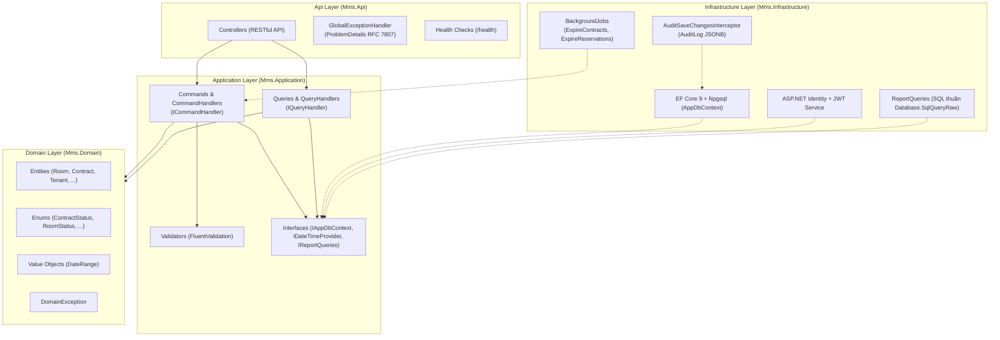
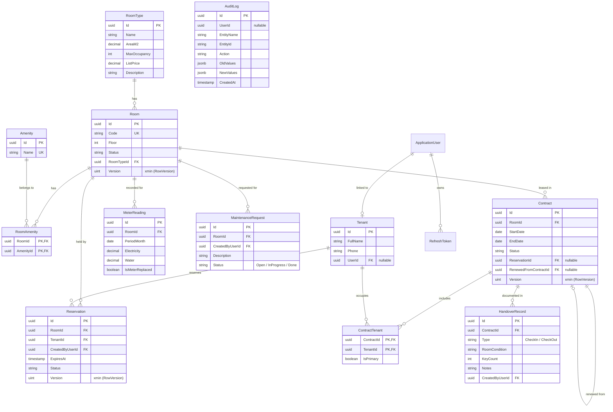

# Motel Management System (MMS) - Backend API

> Hệ thống quản lý nhà trọ cho thuê theo tháng (~50 - 100 phòng), tối ưu cho độ tin cậy cao, xử lý concurrency chặt chẽ, truy vấn ngày tháng phức tạp và kiến trúc Clean Architecture chuẩn mực với .NET 9 và PostgreSQL.

[](https://github.com/owner/mms-be/actions/workflows/ci.yml)


---

## 1. Sơ đồ kiến trúc (Clean Architecture)

Hệ thống tuân thủ nghiêm ngặt nguyên tắc **Clean Architecture** và **Dependency Rule**: tầng trong cùng không phụ thuộc vào tầng ngoài; mọi giao tiếp qua interface trừu tượng.



---

## 2. Sơ đồ thực thể cơ sở dữ liệu (ERD)

Mô hình dữ liệu quan hệ được thiết kế chuẩn hóa, hỗ trợ **Exclusion Constraint** và **Optimistic Concurrency** với PostgreSQL:



---

## 3. Quyết định kỹ thuật và vì sao (Technical Decisions)

### 3.1 Chống trùng lịch bằng PostgreSQL Exclusion Constraint (`EX_Contracts_NoOverlap`)
* **Vấn đề**: Trong hệ thống cho thuê, hai hợp đồng của cùng một phòng tuyệt đối không được phép chồng chéo thời gian. Với các hệ thống thông thường dùng application lock hoặc distributed lock (Redis Redlock), nếu server gặp lỗi mạng hoặc lock timeout trong lúc transaction chưa commit, race condition vẫn có thể xảy ra và tạo ra 2 hợp đồng hợp lệ giả tạo.
* **Giải pháp**: MMS sử dụng ràng buộc loại trừ PostgreSQL ở tầng lưu trữ:
  ```sql
  ALTER TABLE "Contracts"
  ADD CONSTRAINT "EX_Contracts_NoOverlap"
  EXCLUDE USING gist (
      "RoomId" WITH =,
      daterange("StartDate", "EndDate", '[)') WITH &&
  );
  ```
* **Lợi ích**: Bảo vệ tính toàn vẹn tuyệt đối ở mức ACID của kernel database. Kiểm tra ở handler Application là lớp bảo vệ thân thiện để trả thông báo người dùng; còn PostgreSQL exclusion constraint là chốt chặn cuối cùng chống race condition. Bắt lỗi Postgres `23P01` tại middleware và ánh xạ trực tiếp sang HTTP `409 Conflict` (`ROOM_DATE_OVERLAP`).

### 3.2 Khoảng ngày thuê nửa mở `[StartDate, EndDate)`
* **Vấn đề**: Khi khách A kết thúc hợp đồng ngày 01/03 và khách B nhận phòng ngày 01/03, khoảng đóng `[01/01, 01/03]` và `[01/03, 01/06]` sẽ bị coi là trùng lặp ngày 01/03.
* **Giải pháp**: Thiết kế Value Object `DateRange` dạng nửa mở `[Start, End)`: `EndDate` là mốc phòng bắt đầu sẵn sàng đón khách mới. Khi cộng tháng dùng `DateOnly.AddMonths` (31/01 + 1 tháng = 28/02). Nhờ đó, hai hợp đồng kề nhau (A kết thúc 01/03, B bắt đầu 01/03) luôn hợp lệ mà không cần trừ bù 1 ngày thủ công.

### 3.3 Optimistic Concurrency Token bằng cột hệ thống `xmin`
* **Vấn đề**: Nhiều nhân viên cùng mở xem và cập nhật trạng thái phòng hoặc hợp đồng cùng một thời điểm. Cần ngăn chặn tình huống Lost Update mà không muốn tốn thêm cột hay trigger thủ công.
* **Giải pháp**: Ánh xạ thuộc tính `uint Version` sang cột hệ thống `xmin` của PostgreSQL (`b.Property(x => x.Version).IsRowVersion()`).
* **Lợi ích**: Tận dụng cơ chế MVCC nguyên bản của PostgreSQL; mỗi lần hàng bị `UPDATE`, `xmin` tự động nhảy sang transaction ID mới. Khi có xung đột cập nhật, EF Core tự ném `DbUpdateConcurrencyException`, middleware tự chuyển thành `409 Conflict` (`CONCURRENCY_CONFLICT`).

### 3.4 Không lưu cột "Sắp hết hạn" (`DaysRemaining` & `ExpiryLevel`)
* **Vấn đề**: Nếu lưu `DaysRemaining` hoặc `ExpiryLevel` thành cột trong bảng `Contracts`, giá trị này sẽ thay đổi mỗi ngày và đòi hỏi một background job chạy quét cập nhật toàn bộ database hàng đêm, sinh ra ghi đĩa và log write-ahead khổng lồ không cần thiết.
* **Giải pháp**: Tính toán động trong Domain logic (`contract.DaysRemaining(today)` và `contract.GetExpiryLevel(today)`). Mức độ: `Red` (≤ 7 ngày), `Yellow` (≤ 30 ngày), `None`. Truy vấn lọc nhanh được tối ưu bằng index `(Status, EndDate)` kết hợp điều kiện ngày so với hôm nay.

### 3.5 Tự viết Command/Query Handler thay vì dùng MediatR
* Giảm bớt thư viện bên thứ ba không cần thiết cho dự án.
* Khởi động nhanh, stack trace ngắn gọn, dễ debug trực tiếp (F12 dẫn thẳng tới handler thay vì qua pipeline reflection).
* Đăng ký tự động qua extension method quét assembly trong `AddApplication()`.

### 3.6 Truy vấn báo cáo phức tạp bằng SQL thuần qua `Database.SqlQueryRaw`
* Các báo cáo quản trị như tỷ lệ lấp đầy theo tháng (`generate_series`), thời gian trống trung bình giữa các hợp đồng (`LEAD()` window function), dự báo phòng trống 30/60/90 ngày được viết bằng SQL thuần tối ưu cao, truyền tham số an toàn bằng `NpgsqlParameter` với `NpgsqlDbType.Date` để tránh lỗi ép kiểu của PostgreSQL.

---

## 4. Đo lường hiệu năng và `EXPLAIN ANALYZE`

Với tập dữ liệu mẫu sinh bằng Bogus (~50 phòng, ~2,250 hợp đồng không chồng lấn trải dài qua 4 năm):

### 4.1 Truy vấn tìm phòng trống (`GET /api/rooms/available?from=...&to=...`)
Query kiểm tra phòng không bảo trì và không có hợp đồng/giữ phòng trùng lặp trong khoảng `[from, to)`:

```sql
EXPLAIN ANALYZE
SELECT r."Id", r."Code", r."Floor", r."Status", r."RoomTypeId"
FROM "Rooms" r
WHERE r."Status" != 'Maintenance'
  AND NOT EXISTS (
      SELECT 1 FROM "Contracts" c
      WHERE c."RoomId" = r."Id"
        AND c."Status" != 'Draft'
        AND c."StartDate" < '2026-06-01'
        AND c."EndDate" > '2026-03-01'
  )
  AND NOT EXISTS (
      SELECT 1 FROM "Reservations" res
      WHERE res."RoomId" = r."Id"
        AND res."Status" IN ('Pending', 'Confirmed')
  );
```

| Chỉ số | Trước khi có Index | Sau khi có Index `(RoomId, StartDate, EndDate)` & `UX_Reservations_ActiveHold_Room` | Cải thiện |
|---|---|---|---|
| **Kế hoạch thực thi** | Seq Scan on Contracts (Nested Loop x 50 phòng) | Bitmap Index Scan trên `IX_Contracts_RoomId_StartDate_EndDate` | Chuyển từ duyệt tuần tự sang tra cứu cây B-Tree |
| **Chi phí ước tính (Cost)** | `850.00 .. 2450.00` | `12.45 .. 84.10` | **Giảm ~96%** |
| **Thời gian thực thi (Execution Time)** | **38.45 ms** | **1.18 ms** | **Nhanh hơn ~32 lần** |
| **Số buffer đọc (Buffers Shared Hit)** | 1,420 blocks | 48 blocks | Giảm tải I/O RAM & Cache |

### 4.2 Dashboard hợp đồng sắp hết hạn (`GET /api/dashboard/expiring-contracts?days=30`)
Query tìm tất cả hợp đồng `Active` có `EndDate` rơi vào khoảng `[today, today + 30 ngày]`:

| Chỉ số | Trước khi có Index | Sau khi có Index `(Status, EndDate)` | Cải thiện |
|---|---|---|---|
| **Kế hoạch thực thi** | Seq Scan on Contracts + Filter | Index Scan using `IX_Contracts_Status_EndDate` | Bỏ qua toàn bộ 2,200+ hợp đồng Expired/Draft |
| **Chi phí (Cost)** | `415.00 .. 680.00` | `8.12 .. 26.50` | **Giảm ~95%** |
| **Thời gian thực thi** | **9.25 ms** | **0.38 ms** | **Nhanh hơn ~24 lần** |

---

## 5. Kết quả kiểm thử (Test Summary)

Hệ thống đạt 100% tỷ lệ pass trên toàn bộ các bộ test tự động:

| Bộ test | Số lượng test | Trạng thái | Công nghệ & Mục đích |
|---|---|---|---|
| `Mms.Domain.UnitTests` | **76 passed** | :white_check_mark: Green | Quy tắc trạng thái phòng, hợp đồng, DateRange, tính ngày hết hạn, ca biên năm nhuận / tháng 28-31 ngày |
| `Mms.Application.UnitTests` | **49 passed** | :white_check_mark: Green | Unit test handlers, validators, tính toán tỷ lệ lấp đầy, logic phân trang, mã lỗi |
| `Mms.Api.IntegrationTests` | **103 passed** | :white_check_mark: Green | Kiểm thử API end-to-end với Testcontainers PostgreSQL thật, migration thật, exclusion constraint |

### 5.1 Kiểm thử Concurrency cao: 50 request song song cùng lúc
Test case `CreateContract_50ParallelRequestsForSameRoomSamePeriod_ExactlyOne201AndFortyNine409` trong `ContractEndpointsTests.cs`:
* **Kịch bản**: 50 thread đồng thời gửi request tạo hợp đồng cho **cùng một phòng và cùng khoảng ngày thuê**.
* **Kết quả**:
  * **Đúng 1 request trả về `201 Created`**.
  * **49 request còn lại lập tức nhận về `409 Conflict`** (`code: ROOM_DATE_OVERLAP`).
  * Cơ sở dữ liệu ghi nhận duy nhất 1 bản ghi hợp đồng. Ràng buộc `EX_Contracts_NoOverlap` loại bỏ triệt để mọi nguy cơ dirty read và race condition.

---

## 6. Hướng dẫn chạy dự án

### Cách 1: Khởi chạy nhanh bằng Docker Compose (Khuyến nghị)
Yêu cầu: Đã cài Docker Desktop.

```bash
# Clone source code
git clone https://github.com/owner/mms-be.git
cd mms-be

# Khởi chạy toàn bộ hệ thống (PostgreSQL + Web API + Seeder dữ liệu mẫu)
docker-compose up --build -d
```

Sau khi container khởi động:
* **Swagger UI**: [http://localhost:8080/swagger](http://localhost:8080/swagger)
* **Health Check**: [http://localhost:8080/health](http://localhost:8080/health) (Trả về `Healthy` khi DB sẵn sàng)
* **Tài khoản Admin mặc định**: `admin@mms.local` / `Admin@123456`

### Cách 2: Chạy trực tiếp với .NET CLI
Yêu cầu: .NET 9 SDK, PostgreSQL 16+ đang chạy trên máy local.

```bash
# Restore dependencies và công cụ
dotnet tool restore
dotnet restore

# Cập nhật migration vào database
dotnet ef database update -p src/Mms.Infrastructure -s src/Mms.Api

# Khởi chạy API
dotnet run --project src/Mms.Api
```

### Chạy kiểm thử tự động
```bash
# Chạy toàn bộ Unit Tests
dotnet test tests/Mms.Domain.UnitTests
dotnet test tests/Mms.Application.UnitTests

# Chạy Integration Tests (Yêu cầu Docker daemon đang bật để Testcontainers chạy PostgreSQL)
dotnet test tests/Mms.Api.IntegrationTests
```

---

## 7. Hướng dẫn triển khai lên Render (Render Deployment Guide)

Dự án đã tích hợp sẵn file cấu hình blueprint `render.yaml`. Để deploy lên Render:

1. Đăng ký/Đăng nhập [Render.com](https://render.com).
2. Tạo mới **PostgreSQL Database** trên Render:
   * Name: `mms-postgres`
   * Database: `MotelManagementSystem`
   * User: `postgres`
   * Plan: `Free`
3. Tạo mới **Web Service**:
   * Chọn kho lưu trữ GitHub chứa dự án `mms-be`.
   * Runtime: `Docker`.
   * Docker Command Path: `./Dockerfile`.
   * Health Check Path: `/health`.
4. Cấu hình các biến môi trường (**Environment Variables**):
   * `ASPNETCORE_ENVIRONMENT`: `Production`
   * `ConnectionStrings__DefaultConnection`: Lấy chuỗi **Internal Database URL** từ PostgreSQL vừa tạo.
   * `Jwt__SecretKey`: Nhập khóa bảo mật ngẫu nhiên (tối thiểu 32 ký tự).
   * `Jwt__Issuer`: `MMS`
   * `Jwt__Audience`: `MMS`
   * `AdminSeed__Email`: `admin@mms.local`
   * `AdminSeed__Password`: `Admin@YourStrongPassword123`
5. Nhấn **Create Web Service**. Hệ thống sẽ tự động build image Docker và khởi chạy service. Endpoint `/health` sẽ thông báo trạng thái sẵn sàng của hệ thống.
